# Fedora 44 Post-Install: Complete Visual Flowchart & Logic Specification

This document provides a **complete visual flowchart and logic breakdown** of the Fedora 44 Post-Install Setup Script (`setup.sh`).

> [!TIP]
> **Looking for a friendly, non-technical walkthrough instead?**  
> Check out **[HOW_IT_WORKS.md](HOW_IT_WORKS.md)** for the plain-English story, "Before vs After" transformation, peace-of-mind safety rules, and beginner FAQ!

---

## Table of Contents

1. [Master Lifecycle Flowchart](#1-master-lifecycle-flowchart)
2. [Profile Selection & Routing Decision Tree](#2-profile-selection--routing-decision-tree)
3. [Subsystem Flowcharts (Step-by-Step)](#3-subsystem-flowcharts-step-by-step)
   - [Step 1: DNF5 & Repository Setup (`setup_dnf`)](#step-1-dnf5--repository-setup-setup_dnf)
   - [Step 2: DNS Configuration (`setup_dns`)](#step-2-dns-configuration-setup_dns)
   - [Step 3: Core CLI Utilities (`setup_cli_core`)](#step-3-core-cli-utilities-setup_cli_core)
   - [Step 4: Shell, Starship & Modern Terminal (`setup_shell`)](#step-4-shell-starship--modern-terminal-setup_shell)
   - [Step 5: System, Microsoft & Nerd Fonts (`setup_fonts`)](#step-5-system-microsoft--nerd-fonts-setup_fonts)
   - [Step 6: Multimedia Codecs & Dynamic PipeWire Audio (`setup_multimedia`)](#step-6-multimedia-codecs--dynamic-pipewire-audio-setup_multimedia)
   - [Step 7: GNOME Desktop Polish & GSConnect (`setup_gnome`)](#step-7-gnome-desktop-polish--gsconnect-setup_gnome)
   - [Step 8: Desktop Applications & Productivity (`setup_desktop_apps`)](#step-8-desktop-applications--productivity-setup_desktop_apps)
   - [Step 9: Power Policies & High-Performance ZRAM (`setup_power`)](#step-9-power-policies--high-performance-zram-setup_power)
   - [Step 10: Modular Development Toolchains (`setup_dev`)](#step-10-modular-development-toolchains-setup_dev)
   - [Step 11: Code Editor Suite & Polyglot Runner (`setup_editor`)](#step-11-code-editor-suite--polyglot-runner-setup_editor)
   - [Step 12: Docker Container Engine (`setup_docker`)](#step-12-docker-container-engine-setup_docker)
   - [Step 13: KVM/QEMU Hardware Virtualization (`setup_kvm`)](#step-13-kvmqemu-hardware-virtualization-setup_kvm)
   - [Step 14: Gaming Stack & Heroic (`setup_gaming`)](#step-14-gaming-stack--heroic-setup_gaming)
   - [Step 15: Creator & Streaming Suite (`setup_creator`)](#step-15-creator--streaming-suite-setup_creator)
   - [Step 16: Pre-Driver Kernel Gate (`setup_pre_driver_reboot`)](#step-16-pre-driver-kernel-gate-setup_pre_driver_reboot)
   - [Step 17: Multi-Vendor GPU Drivers & Secure Boot MOK (`setup_drivers`)](#step-17-multi-vendor-gpu-drivers--secure-boot-mok-setup_drivers)
   - [Summary & Health Check (`show_summary`)](#summary--health-check-show_summary)
4. [Idempotency, State & Rollback Flowchart](#4-idempotency-state--rollback-flowchart)

---

## 1. Master Lifecycle Flowchart

The high-level execution pipeline from CLI invocation (or curl pipe) to system readiness:

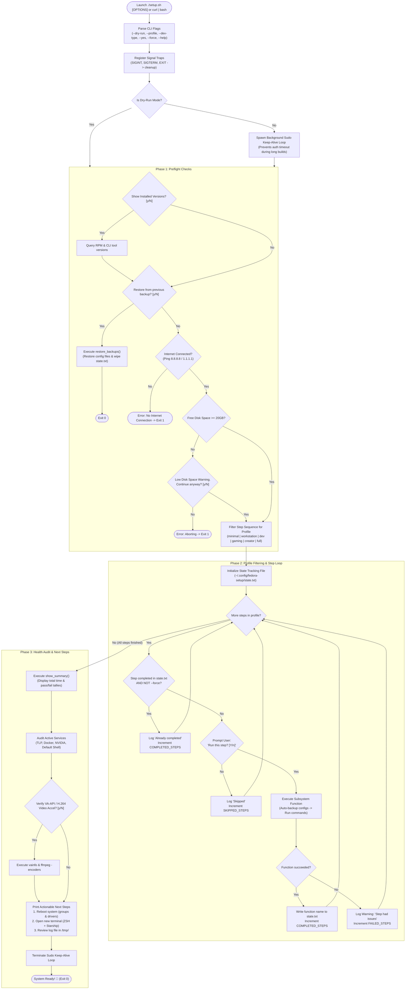

---

## 2. Profile Selection & Routing Decision Tree

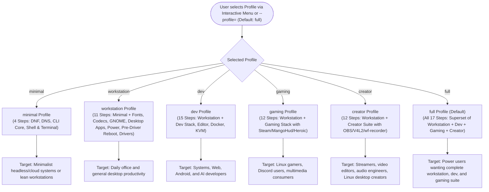

---

## 3. Subsystem Flowcharts (Step-by-Step)

### Step 1: DNF5 & Repository Setup (`setup_dnf`)

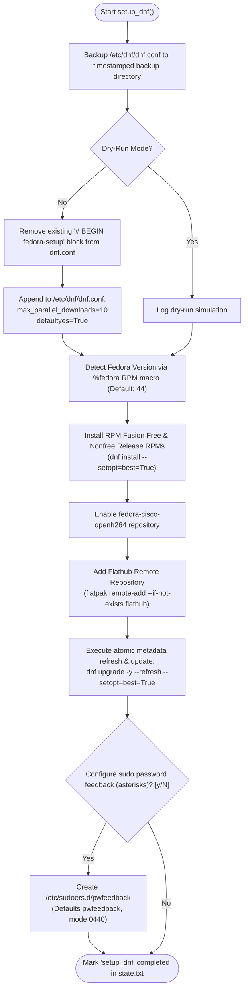

---

### Step 2: DNS Configuration (`setup_dns`)

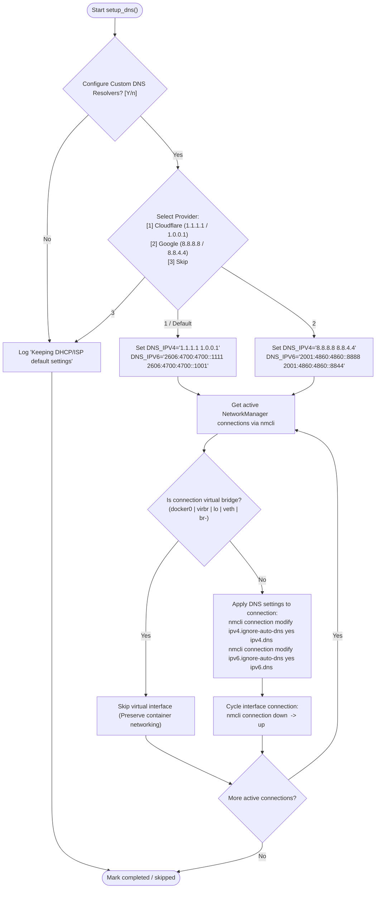

---

### Step 3: Core CLI Utilities (`setup_cli_core`)

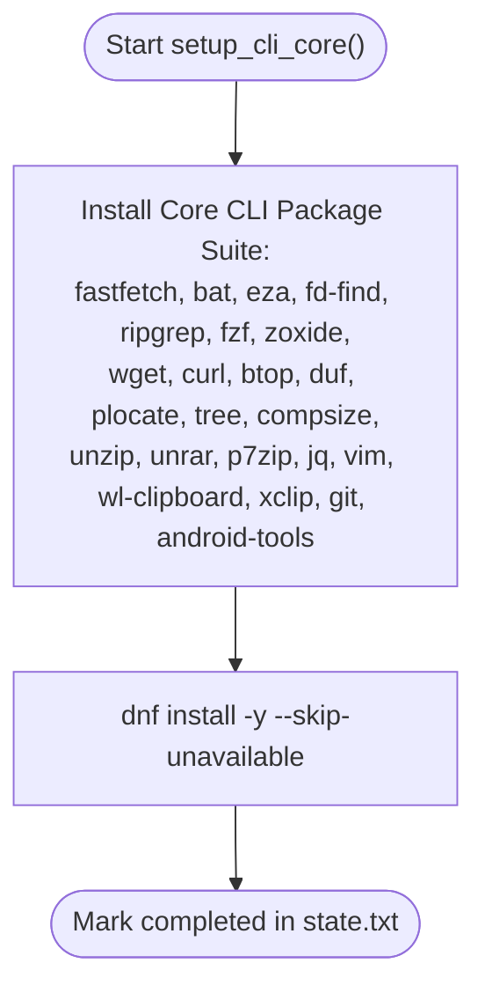

---

### Step 4: Shell, Starship & Modern Terminal (`setup_shell`)

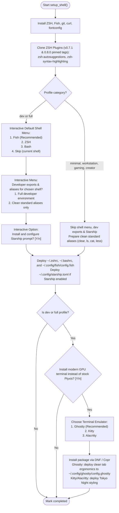

---

### Step 5: System, Microsoft & Nerd Fonts (`setup_fonts`)

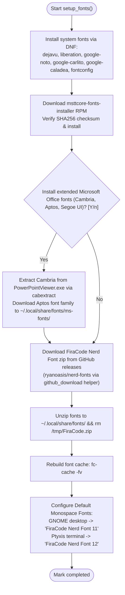

---

### Step 6: Multimedia Codecs & Dynamic PipeWire Audio (`setup_multimedia`)

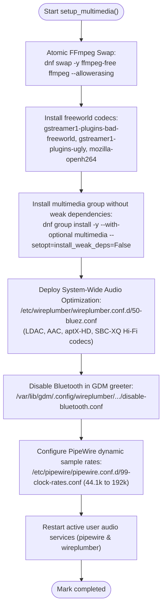

---

### Step 7: GNOME Desktop Polish & GSConnect (`setup_gnome`)

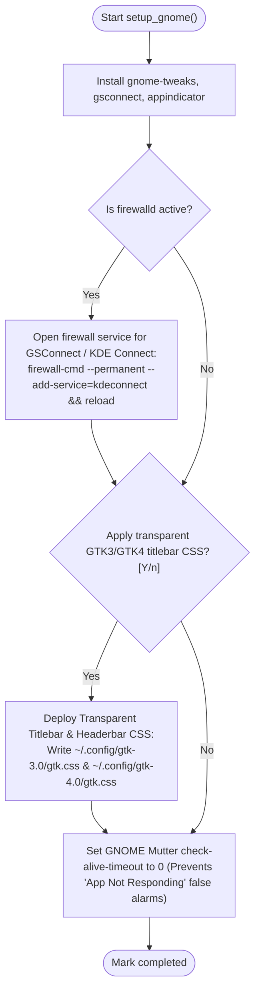

---

### Step 8: Desktop Applications & Productivity (`setup_desktop_apps`)

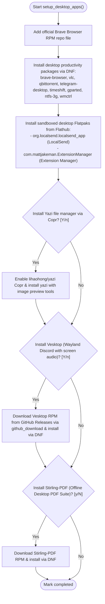

---

### Step 9: Power Policies & High-Performance ZRAM (`setup_power`)

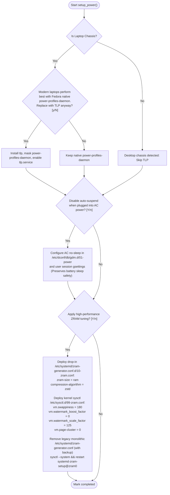

---

### Step 10: Modular Development Toolchains (`setup_dev`)

```mermaid
flowchart TD
    StartDev(["Start setup_dev()"]) --> SelectGenres["Evaluate dev genres: --dev-type or interactive<br/>(systems, web, android, ai, all)"]
    SelectGenres --> BuildPkgs["Build dev_pkgs list:<br/>Base: meson, ninja, automake, gdb, valgrind, strace, git-lfs, python3-devel<br/>Systems: gcc, clang, llvm, make, cmake<br/>Web: nodejs, npm<br/>Android: java-latest-openjdk, maven<br/>AI: python3-pip, virtualenv, wheel, ruff, uv"]
    BuildPkgs --> InstallDevPkgs["Execute: dnf install -y --skip-unavailable dev_pkgs"]
    
    InstallDevPkgs --> CheckSystemsGenre{"Has 'systems' genre?"}
    CheckSystemsGenre -- Yes --> RustPrompt{"Install full Rust toolchain (rustup, clippy, rust-analyzer)? [Y/n]"}
    RustPrompt -- Yes --> InstallRust["Install rust, cargo, rustup, clippy, rust-analyzer"] --> CcachePrompt
    RustPrompt -- No --> CcachePrompt
    
    CcachePrompt{"Install and configure ccache (50GB compressed)? [Y/n]"}
    CcachePrompt -- Yes --> InstallCcache["Install ccache & configure 50GB limit with compression"] --> CheckAndroidGenre
    CcachePrompt -- No --> CheckAndroidGenre
    CheckSystemsGenre -- No --> CheckAndroidGenre
    
    CheckAndroidGenre{"Has 'android' genre?"}
    CheckAndroidGenre -- Yes --> AndroidStudioPrompt{"Install Android Studio (via Flathub)? [Y/n]"}
    AndroidStudioPrompt -- Yes --> InstallAndroidStudio["flatpak install flathub com.google.AndroidStudio"] --> ScrcpyPrompt
    AndroidStudioPrompt -- No --> ScrcpyPrompt
    ScrcpyPrompt{"Install Scrcpy low-latency screen mirror via Copr? [Y/n]"}
    ScrcpyPrompt -- Yes --> InstallScrcpy["Enable zeno/scrcpy Copr & install scrcpy"] --> CheckAIGenre
    ScrcpyPrompt -- No --> CheckAIGenre
    CheckAndroidGenre -- No --> CheckAIGenre
    
    CheckAIGenre{"Has 'ai' genre?"}
    CheckAIGenre -- Yes --> CheckCompute{"Probe GPU for Compute:"}
    CheckCompute -- NVIDIA --> CudaPrompt{"Install NVIDIA CUDA development libraries? [Y/n]"}
    CudaPrompt -- Yes --> InstallCuda["dnf install xorg-x11-drv-nvidia-cuda-devel"] --> CheckWebGenre
    CudaPrompt -- No --> CheckWebGenre
    CheckCompute -- AMD --> ROCmPrompt{"Install AMD ROCm OpenCL / HIP? [Y/n]"}
    ROCmPrompt -- Yes --> InstallROCm["dnf install rocm-opencl rocm-hip"] --> CheckWebGenre
    ROCmPrompt -- No --> CheckWebGenre
    CheckCompute -- Intel --> IntelComputePrompt{"Install Intel Compute Runtime (oneAPI / Level Zero)? [Y/n]"}
    IntelComputePrompt -- Yes --> InstallIntelCompute["dnf install intel-compute-runtime intel-opencl level-zero"] --> CheckWebGenre
    IntelComputePrompt -- No --> CheckWebGenre
    CheckAIGenre -- No --> CheckWebGenre
    
    CheckWebGenre{"Has 'web' genre?"}
    CheckWebGenre -- Yes --> EnableCorepack["Enable Node.js Corepack (yarn/pnpm)"] --> PythonSymlink
    CheckWebGenre -- No --> PythonSymlink
    
    PythonSymlink["Create ~/.local/bin/python symlink"] --> GitWorkflowPrompt{"Configure Git workflow defaults (autoSetupRemote, pull.rebase, diff.colorMoved)? [y/N]"}
    GitWorkflowPrompt -- Yes --> BackupAndSetGit["Backup ~/.gitconfig<br/>git config --global push.autoSetupRemote true<br/>git config --global pull.rebase true<br/>git config --global diff.colorMoved zebra"] --> PGPrompt
    GitWorkflowPrompt -- No --> PGPrompt
    
    PGPrompt{"Install and initialize PostgreSQL Server? [y/N]"}
    PGPrompt -- Yes --> InstallPG["Architecture-aware install (PGDG repo for x86_64, Fedora native for others)<br/>Initialize DB & enable postgresql service"] --> EndDev(["Mark completed"])
    PGPrompt -- No --> EndDev
```

---

### Step 11: Code Editor Suite & Polyglot Runner (`setup_editor`)

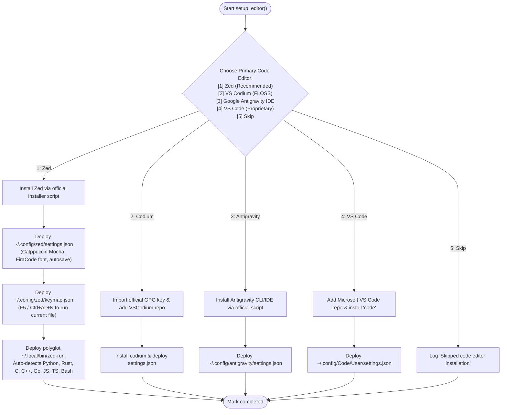

---

### Step 12: Docker Container Engine (`setup_docker`)

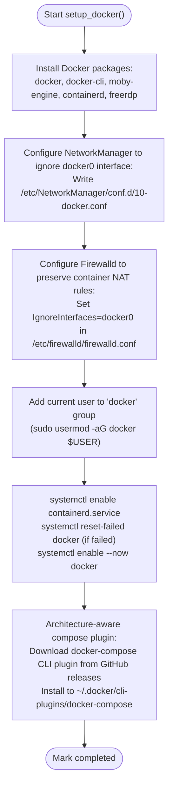

---

### Step 13: KVM/QEMU Hardware Virtualization (`setup_kvm`)

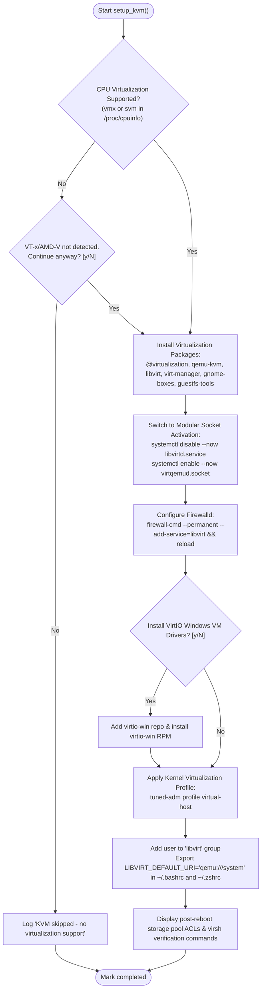

---

### Step 14: Gaming Stack & Heroic (`setup_gaming`)

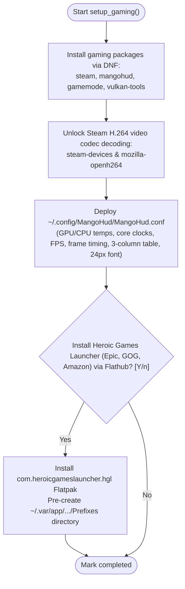

---

### Step 15: Creator & Streaming Suite (`setup_creator`)

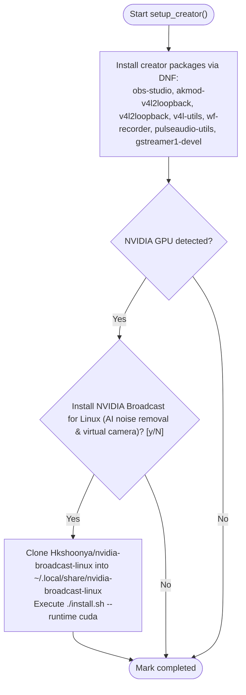

---

### Step 16: Pre-Driver Kernel Gate (`setup_pre_driver_reboot`)

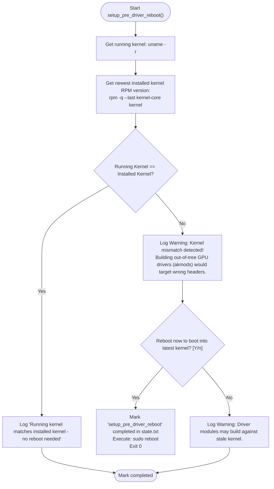

---

### Step 17: Multi-Vendor GPU Drivers & Secure Boot MOK (`setup_drivers`)

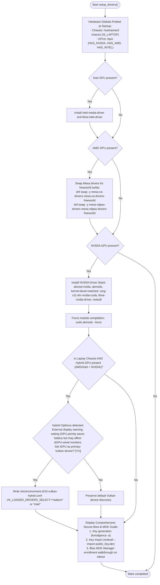

---

### Summary & Health Check (`show_summary`)

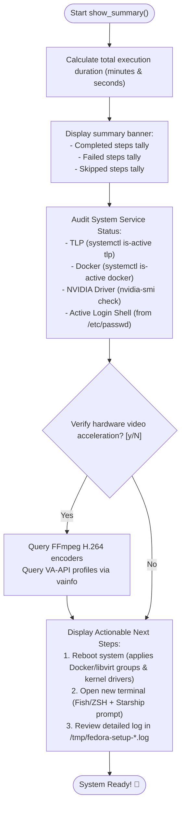

---

## 4. Idempotency, State & Rollback Flowchart

How `setup.sh` handles step resumption, failure recovery, and backup restoration:

```mermaid
flowchart TD
    subgraph StateResumption ["Resumption & Interruption Lifecycle"]
        Launch["User runs ./setup.sh or curl | bash"] --> ReadStateFile["Read ~/.config/fedora-setup/state.txt"]
        ReadStateFile --> StepEvaluator{"For each step in active profile"}
        
        StepEvaluator --> StepInState{"Step function name<br/>present in state.txt?"}
        StepInState -->|"Yes (No --force)"| SkipToNext["Skip step execution<br/>(Zero redundant downloads or writes)"]
        SkipToNext --> StepEvaluator
        StepInState -->|"No (Or --force passed)"| PromptAndRun["Prompt user & Execute step function"]
        
        PromptAndRun --> StepSuccess{"Execution succeeded?"}
        StepSuccess -->|"Yes"| AppendState["Append function name to state.txt"]
        AppendState --> StepEvaluator
        StepSuccess -->|"No"| PreserveState["Do NOT write to state.txt<br/>(Step will re-prompt on next run)"]
        PreserveState --> StepEvaluator
    end

    subgraph RollbackEngine ["Disaster Recovery & Rollback Subsystem"]
        RunRestore["User launches ./setup.sh -> Confirms 'Restore from previous backup?'"] --> ScanBackups["Find newest directory in ~/.config/fedora-setup-backups/YYYYMMDD_HHMMSS/"]
        ScanBackups --> FoundBackups{"Backup directory found?"}
        FoundBackups -->|"No"| LogNoBackup["Log 'No backups found' -> Exit 1"]
        FoundBackups -->|"Yes"| ConfirmRestore{"Restore all files from this timestamp? [y/N]"}
        
        ConfirmRestore -->|"Yes"| RestoreFiles["Restore original files from timestamped backup:<br/>- ~/.zshrc<br/>- ~/.bashrc<br/>- ~/.gitconfig<br/>- /etc/dnf/dnf.conf<br/>- /etc/systemd/zram-generator.conf<br/>- ~/.config/MangoHud/MangoHud.conf<br/>- ~/.config/starship.toml<br/>- ~/.config/ghostty/config.ghostty<br/>- ~/.config/kitty/kitty.conf<br/>- ~/.config/alacritty/alacritty.toml"]
        RestoreFiles --> WipeState["Delete ~/.config/fedora-setup/state.txt<br/>(Resets state so future runs re-evaluate cleanly)"]
        WipeState --> ExitRestore(["Exit 0 (System restored to original clean state)"])
        ConfirmRestore -->|"No"| CancelRestore(["Cancel restore"])
    end
```
